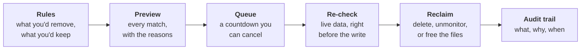

<p align="center">
  
</p>

<h1 align="center">Cleanarr</h1>

<p align="center">
  <strong>Get your storage back without losing what you love.</strong><br>
  Rule-based library cleanup for Sonarr and Radarr, driven by what your household actually watches and requests.
</p>

<p align="center">
  <a href="#quick-start">Quick start</a> ·
  <a href="#how-it-works">How it works</a> ·
  <a href="#built-to-never-surprise-you">Safety</a> ·
  <a href="#what-you-can-ask-it">Rules</a> ·
  <a href="#reference">Reference</a>
</p>

<p align="center">
  
  
  
  
  
  
</p>

---

## Your library is full. Deciding what goes is the hard part.

Nobody wants to scroll four thousand titles asking *did anyone ever watch this?* And nobody wants an automation
that guesses.

Cleanarr asks the questions you would, across your whole library, and shows its working:

> *Added over a year ago. Nobody has watched it in six months. The person who requested it already has. It isn't tagged "keep".*

Match those, and it queues the title for removal with a countdown. Miss any one, and it leaves it alone.

---

## Why Cleanarr

|  |  |
|---|---|
| **Evidence, not guesses**<br>Sonarr and Radarr describe the library. Plex says who watched what and when. Seerr says who asked for it. Rules combine all three. | **Safe by design**<br>Dry run is the default. Matches wait in a queue. Everything is re-checked against live data right before it is touched. Missing evidence blocks a removal; it never allows one. |
| **Explains every decision**<br>Press **Why?** on any title and see each condition, what it found, and whether it passed. | **Built for a quick check-in**<br>One dashboard, a clear mode indicator, and a layout that works from your phone. Light and dark follow your system. |
| **Keeps what matters**<br>Protect rules beat cleanup rules. Pin a title by hand. Tag something *keep* in Sonarr or Radarr and it is safe. | **Yours, on your network**<br>One container, one SQLite file, your keys encrypted at rest. No account and no cloud service to sign up for. |

---

## How it works



1. **Connect** Sonarr and Radarr, then add Plex and Seerr if you want rules that use watch history and requests.
2. **Describe** what should go with a template or the condition builder, and what should always stay with protect rules.
3. **Preview** everything that would match, with the reasons, while nothing is changed.
4. **Go live** when the preview looks right. Matches queue, count down, are re-validated, and are removed. You can step in at any point.

A schedule is optional. Run it daily, weekly or monthly, or press **Reclaim now** when you want space back.

---

## Built to never surprise you

Safety is the product. Cleanarr is deliberately cautious, and each layer assumes the one before it might be wrong.

| | |
|---|---|
| **Starts in dry run** | Nothing is changed and nothing is queued until you turn it off. Preview and trial runs never write, even when live. |
| **Waits before it acts** | Live matches sit in a queue for a delay you choose (3 days by default). Titles that stop matching drop out on their own. |
| **Re-checks at the last moment** | Right before any write, the item is re-read from Sonarr or Radarr. If its path, ids, size or files changed, or a rule no longer agrees, the removal is blocked. |
| **Unknown never matches** | Rules are true, false or *unknown*. If Plex or Seerr is unreachable, or an id is missing, the answer is unknown and a cleanup rule will not fire. An unknown *protect* rule protects. |
| **Protection always wins** | Protect rules outrank every cleanup rule, and titles you pin by hand are never touched. |
| **Bounded blast radius** | A per-run cap limits how much one run can do. If an instance can't be read, it is skipped, never treated as empty. |
| **One run at a time** | A lease stops overlapping runs. Approvals are compare-and-set, so a double click can't execute twice. |
| **A record of everything** | An append-only audit trail logs every proposal, block, failure and removal. |

---

## What you can ask it

Rules are plain conditions combined with **and**, **or** and **not**, evaluated in priority order.

| Group | Examples |
|---|---|
| **Library** | Age in library, size, rating, IMDb rating, content rating or "suitable for kids", release status, monitored state, genre, year, quality profile, language, tags, path, runtime |
| **File quality** | Resolution, video and audio codec, channels, HDR type, custom format score, release group |
| **Watch history** (Plex) | Last watched, play count, watched by, an episode nobody has watched in a while |
| **Requests** (Seerr) | Requested or not, requested by, request age and count, **the requester has watched it**, **the requester watched the whole season** |

**What it can do to a match:**

- **Delete**: remove from Sonarr or Radarr and delete the files
- **Unmonitor**: keep everything, stop downloading
- **Delete files**: keep the entry, free the space
- **Delete season**: Sonarr only, one season at a time

Different actions for movies, continuing shows and ended shows are a single rule away.

**Start from a template:** *Added and not watched for 60 days*, *Last watched over a year ago*, *Requester watched it, no one since*,
*Ended series with no monitored seasons*, *Protect kids content*, *Protect anything watched recently*, *Protect new additions*,
*Protect fresh requests*, *Protect the "keep" tag*, *Protect shows still airing*. Rules can be imported and exported as JSON.

---

## Your day-to-day

| | |
|---|---|
| **Dashboard** | Reclaimable space at a glance, what's queued and when it lands, and what each rule is responsible for |
| **Library** | Browse, search, filter and sort everything; open a title to see why it is or isn't a match |
| **Rules** | Templates, condition builder with JSON mode, reordering, import and export |
| **History** | Every run with per-item outcomes, plus the full audit trail |
| **Instances** | Connections with a one-click test |
| **Settings** | Dry run, schedule, run cap, queue delay, kids' age limit, audit retention |

---

## Quick start

**Docker**

```bash
docker compose up -d --build        # then open http://localhost:8080
```

**Node 22+**

```bash
npm install
npm run build
CLEANARR_API_KEY=change-me npm start
```

**Unraid**: add the template manually from
`https://raw.githubusercontent.com/Daneng66/Cleanarr/main/unraid/cleanarr.xml`. The image is `ghcr.io/daneng66/cleanarr`.

Then:

1. **Instances**: add Sonarr and Radarr, plus Plex and Seerr if you use them. Use the Plex server **owner's** token so every user's history is visible.
2. **Rules**: pick a template or two.
3. **Dashboard**: read the preview and press **Why?** on a few titles.
4. **Settings**: when you trust it, turn off dry run.

> Set `CLEANARR_API_KEY` if the port is reachable by anyone else on your network.

---

## Reference

<details>
<summary><strong>Configuration</strong></summary>

| Variable | Default | Purpose |
|---|---|---|
| `PORT` / `HOST` | `8080` / `0.0.0.0` | Listen address |
| `DATA_DIR` | `./data` (`/data` in Docker) | SQLite database and generated secret |
| `CLEANARR_API_KEY` | none | Requires `Authorization: Bearer <key>` (or `X-Api-Key`) for the API; the UI prompts for it |
| `SECRET_KEY` | generated into `DATA_DIR/secret.key` | Encrypts stored service keys and tokens (AES-256-GCM) |
| `LOG_LEVEL` | `info` | pino log level |

Service API keys are write-only and never returned by the API. Everything else (dry run, schedule, run cap, queue delay,
kids' age, audit retention) lives under **Settings**.

**Scheduling.** With *Run on a schedule* on, Cleanarr runs every N days, weeks or months at a server-local time. Dry run does
not stop the schedule: scheduled runs still happen and record what they would do. Turning the schedule on, or turning dry run
off, runs once right away instead of waiting a full interval.

</details>

<details>
<summary><strong>API</strong></summary>

All endpoints are under `/api` (`GET /healthz` is unauthenticated).

| Area | Endpoints |
|---|---|
| Meta | `GET /auth`, `GET /status`, `GET /rule-types`, `GET /rule-templates`, `GET /requesters` |
| Instances | `/instances` (+ `/:id`, `/:id/test`), `POST /instances/test` |
| Settings | `GET` / `PUT /config` |
| Rules | `/rules` (+ `/:id`), `PUT /rules/reorder` |
| Runs | `POST /preview`, `POST /run` (`dryRun`, `immediate`, `only`), `POST /explain` |
| Library | `POST /library`, `POST /library/remove`, `GET /series/:instanceId/:seriesId/episodes`, `GET /link/:instanceId/:arrItemId` |
| Queue | `GET /approvals`, `POST /approvals/:id/approve`, `POST /approvals/:id/retry` |
| Protection | `GET` / `POST /protected`, `DELETE /protected/:id` |
| History | `GET /logs`, `GET /logs/:id`, `GET /audit` |

A rule in JSON:

```json
{ "op": "and", "of": [
  { "type": "age", "params": { "operator": "older_than", "days": 365 } },
  { "type": "last_watched", "params": { "operator": "not_watched_in_days", "days": 180 } },
  { "op": "not", "of": { "type": "tag_match", "params": { "operator": "includes_any", "tags": ["keep"] } } }
] }
```

</details>

<details>
<summary><strong>Good to know</strong></summary>

- Targets are whole movies, whole series and whole seasons, not individual episodes.
- After a removal, Cleanarr clears the title's request in Seerr (best effort; a Seerr failure is logged and does not retry the removal).
- Plex picks up deletions on its next scan. Triggering a scan from Cleanarr isn't implemented yet.
- SABnzbd needs no connection: Cleanarr works on the library, not the download queue.
- Single user with an optional API key. No accounts, notifications, or backup/restore yet.
- Run Cleanarr on the same Docker network as your other containers and use their names in instance URLs
  (e.g. `http://radarr:7878`, `http://plex:32400`, `http://seerr:5055`).

</details>

<details>
<summary><strong>Development</strong></summary>

```bash
npm run dev:api     # API with tsx watch, on :8080
npm run dev:web     # Vite dev server for the React UI
npm run typecheck   # server and web
npm test            # vitest: rules, engine safety paths, Plex/Seerr providers, API
npm run build       # tsc → dist/, vite → dist/web
```

- `src/rules`: condition registry, three-valued evaluator, templates, per-slot actions, ReDoS-screened regex
- `src/cleanup`: the engine (planning, queueing, revalidation, execution) and the scheduler
- `src/store.ts`, `src/db.ts`: SQLite persistence and migrations
- `src/arr`, `src/watch`, `src/seerr`: Sonarr/Radarr, Plex and Seerr clients
- `src/server.ts`: Fastify API, serves the built UI from `dist/web`
- `web/`: React + Vite UI

Images are built for `linux/amd64` and `linux/arm64` and published to GHCR on every push to `main` and on `v*` tags.

</details>
